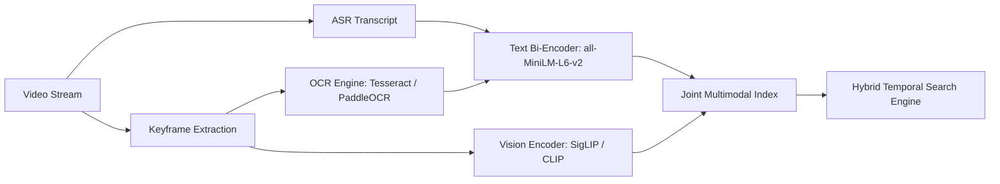

# Future Research Roadmap & Architectural Extensions: VidQuery

This document outlines the theoretical formulations, system architectures, and implementation blueprints for future extensions of the **VidQuery** framework, addressing the primary limitations formalized in Section VII of our IEEE manuscript (*Search Space Expansion*, *ASR Word Error Rate Degradation*, and *Unimodal Text-Only Information Loss*).

---

## 1. Two-Stage Hierarchical Temporal Retrieval (Macro + Micro Indexing)

### 1.1 The Theoretical Problem
In Section V-C, we formalized the **Search Space Expansion Effect**: on lectures exceeding 35 minutes, flat dense bi-encoder retrieval degrades from **23.3% Hit@1 to 3.3%**. Because fundamental technical terms (*loss*, *gradient*, *activation*) repeat across introductory, theoretical, implementation, and Q&A sections, flat cosine similarity compresses into a narrow band, causing top-1 false positives.

### 1.2 The Two-Stage Solution Architecture
Instead of flattening an entire 2-hour lecture into a single index of 800+ chunks, we introduce a **hierarchical two-tier tree structure**:

```
[2-Hour Lecture Video]
         │
         ├── Macro-Index (Stage 1: Lecture Segments / 5-10 min Windows)
         │       ├── Chapter 1: Geometric Intuition [00:00 - 15:00]
         │       ├── Chapter 2: Mathematical Proof   [15:00 - 45:00]  <-- Selected Window
         │       └── Chapter 3: Code Implementation  [45:00 - 90:00]
         │
         └── Micro-Index (Stage 2: 120-Word Fine Chunks within Selected Window)
                 ├── Chunk 2.1: Matrix rank definition [15:00 - 17:30]
                 ├── Chunk 2.2: Row space vs Nullspace [17:10 - 19:40]  <-- Exact Target
                 └── Chunk 2.3: Elimination algorithm [19:20 - 21:50]
```

### 1.3 Algorithmic Execution
1. **Stage 1 (Macro-Partitioning):**
   - Video is divided into $K$ macroscopic windows (either via YouTube timestamp chapters or fixed 10-minute overlapping blocks).
   - A hybrid **BM25 + Dense Macro-Embedding** identifies the top candidate macro-windows ($M \le 2$).
2. **Stage 2 (Micro-Localization & Cross-Encoder Reranking):**
   - Retrieval is restricted strictly to the micro-chunks belonging to the top-$M$ candidate windows (reducing search space from 800 to ~40 chunks).
   - A cross-encoder reranker (e.g., `BAAI/bge-reranker-large`) computes joint query-passage attention:
     $$S_{\text{rerank}}(q, c) = \text{Softmax}\left(W \cdot \text{Transformer}([q; c])\right)$$
   - This resolves subtle distinctions between an introductory mention and the authoritative theoretical derivation.

---

## 2. Multimodal Slide & Visual Keyframe Fusion

### 2.1 The Theoretical Problem
In STEM lectures (e.g., 3Blue1Brown animations or MIT chalkboard derivations), lecturers frequently reference visual diagrams deictically (*"look at this vector here"*, *"this curve represents the objective function"*). Pure ASR transcripts lack these visual spatial cues.

### 2.2 The Multimodal Fusion Architecture



### 2.3 Keyframe Transition Detection
Keyframes are extracted by computing structural similarity across successive video frames sampled at 1 FPS:
$$\Delta(F_t, F_{t + \Delta t}) = 1 - \text{SSIM}(F_t, F_{t + \Delta t})$$
When $\Delta(F_t, F_{t + \Delta t}) > \tau_{\text{threshold}}$, a slide transition is registered, creating a visual bounding anchor.

### 2.4 Multimodal Scoring Function
For a user query $q$ and a candidate temporal chunk $c_t$ containing both speech transcript $T_t$ and associated slide frame $I_t$:
$$S_{\text{multimodal}}(q, c_t) = \alpha \cdot \cos\left(\mathbf{e}_{\text{text}}(q), \mathbf{e}_{\text{text}}(T_t)\right) + \beta \cdot \cos\left(\mathbf{e}_{\text{vision}}(q), \mathbf{e}_{\text{vision}}(I_t)\right) + \gamma \cdot \text{BM25}\left(q, \text{OCR}(I_t)\right)$$
Where $\alpha + \beta + \gamma = 1.0$, optimized via grid search on multimodal lecture benchmarks.

---

## 3. Acoustic Confidence Score Filtering for Low-Resource / Accented Transcripts

### 3.1 The Theoretical Problem
In classroom recordings with reverberation or non-native accents (e.g., NPTEL Tier C), ASR models output phonetically hallucinated tokens. Standard RAG indexes these erroneous tokens as ground truth.

### 3.2 Acoustic Confidence Weighting
When running local Whisper transcription, Whisper outputs token-level log probabilities:
$$p_i = \exp\left(\text{logprob}(w_i)\right) \in [0, 1]$$
We define the **Acoustic Confidence Index (ACI)** for a 120-word chunk $c$ as:
$$\text{ACI}(c) = \frac{1}{|c|} \sum_{w_i \in c} p_i$$

### 3.3 Confidence-Aware Retrieval Discounting
Chunks with high acoustic uncertainty are downweighted during retrieval:
$$S_{\text{acoustic\_aware}}(q, c) = \text{Sim}_{\text{dense}}(q, c) \cdot \left(\lambda + (1 - \lambda) \cdot \text{ACI}(c)\right)$$
Where $\lambda \in [0.5, 0.8]$ sets a baseline floor. If an ASR chunk has low acoustic confidence, it cannot rank as top-1 unless its dense semantic match is exceptionally strong.

---

## 4. Implementation Phasing Roadmap

| Phase | Milestone | Primary Deliverable | Target Timeline |
| :---: | :--- | :--- | :--- |
| **Phase 1** | **Hierarchical Indexing Engine** | Implement 2-stage macro/micro retrieval with BM25 + Qdrant in `vectorstore.py`. | Month 1–2 |
| **Phase 2** | **Cross-Encoder Reranker** | Integrate `bge-reranker-base` to optimize top-1 localization precision. | Month 2–3 |
| **Phase 3** | **Keyframe Extraction & OCR** | Implement OpenCV slide transition detection and OCR caption enhancement. | Month 4–5 |
| **Phase 4** | **Acoustic Logprob Fusion** | Extract Whisper segment confidence weights and apply confidence discounting. | Month 5–6 |
| **Phase 5** | **Expanded Multi-Disciplinary Benchmark** | Extend dataset to 500+ questions across Medical, Law, and Humanities lectures. | Month 6–8 |
